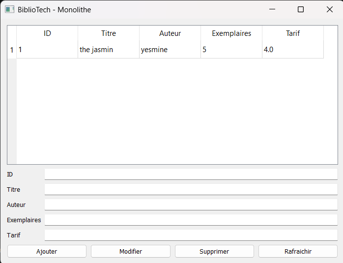
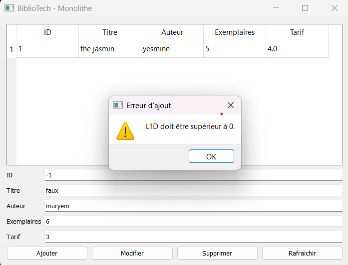
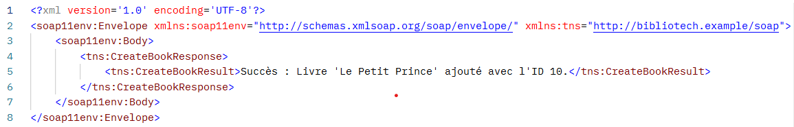
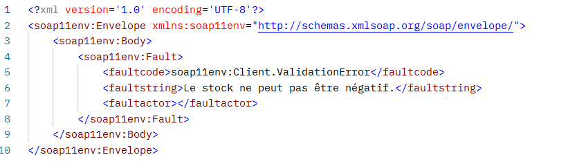

# Lab 1 — From Monolith to SOAP & REST Web Services

**Réalisé par :** Yesmine Saied — IA3.1  
**Cours :** Architecture Orientée Service (SOA)

---

## Partie 1 — Version monolithique (sans SOA)

### Objectif

Implémenter toute la logique de gestion de la bibliothèque dans un seul script Python. L'interface utilisateur (PyQt5) et l'accès à la base de données (SQLAlchemy/PostgreSQL) sont centralisés dans le fichier `monolith.py`.

### Fonctionnalités implémentées

- Connexion à la base de données PostgreSQL via SQLAlchemy.
- Opérations CRUD (Ajouter, Lire, Modifier, Supprimer) fonctionnelles sur la table `Book`.
- Validation stricte des données :
  - Blocage des identifiants invalides.
  - Interdiction des stocks négatifs.
  - Interdiction des tarifs négatifs.

### Question — Quelles sont les limites de cette approche monolithique ?

L'approche monolithique, bien que simple à mettre en place initialement, présente plusieurs limites majeures :

1. **Couplage fort :** le code de l'interface graphique (UI) est intimement lié à la logique métier et à l'accès aux données. Une modification de la base de données implique souvent de retoucher l'interface.

2. **Fermeture au réseau :** le système n'est pas distribué et s'exécute uniquement en local. Il est impossible pour d'autres clients, comme une application mobile ou un site web externe, de consommer ces données, car aucune API n'est exposée.

3. **Problème d'évolutivité (Scalability) :** si l'application s'enrichit de nouvelles fonctionnalités, le fichier unique deviendra très lourd, difficile à maintenir, à tester et à faire évoluer en équipe.

### Captures d'écran — Tests de la partie 1

#### 1. Test de succès : ajout et affichage des livres



#### 2. Test de validation : erreur bloquée lors d'une saisie invalide



---

## Partie 2 — Service Web SOAP

### Lancement du service

Pour démarrer le service SOAP, exécuter la commande suivante depuis un terminal ouvert à la racine du projet :

```bash
python soap_service.py
```

Le serveur écoutera à l'adresse suivante :

[http://localhost:8000/](http://localhost:8000/)

### WSDL

Le contrat du service est accessible via l'URL suivante :

[http://localhost:8000/?wsdl](http://localhost:8000/?wsdl)

Le fichier WSDL a été sauvegardé à la racine du dépôt sous le nom `library.wsdl`.

### Tests Postman

**1. Test de succès : création d'un livre valide.**


**2. Test d'erreur : validation interceptée lors de la saisie d'un stock négatif.**


### Question 6 — En quoi SOAP impose-t-il davantage de structure et de contrats que le monolithe ?

SOAP impose un contrat rigide via le fichier WSDL et utilise un format de transport structuré en XML. Contrairement au monolithe, où les composants communiquent de manière implicite via des objets Python en mémoire, SOAP oblige le client et le serveur à respecter les types de données (`Integer`, `String`, etc.) définis à l'avance.

La gestion des exceptions est également encadrée : toute erreur métier locale, comme une `ValueError`, doit être standardisée sous la forme d'une balise `<soap11env:Fault>` pour garantir l'interopérabilité avec des clients distants.
