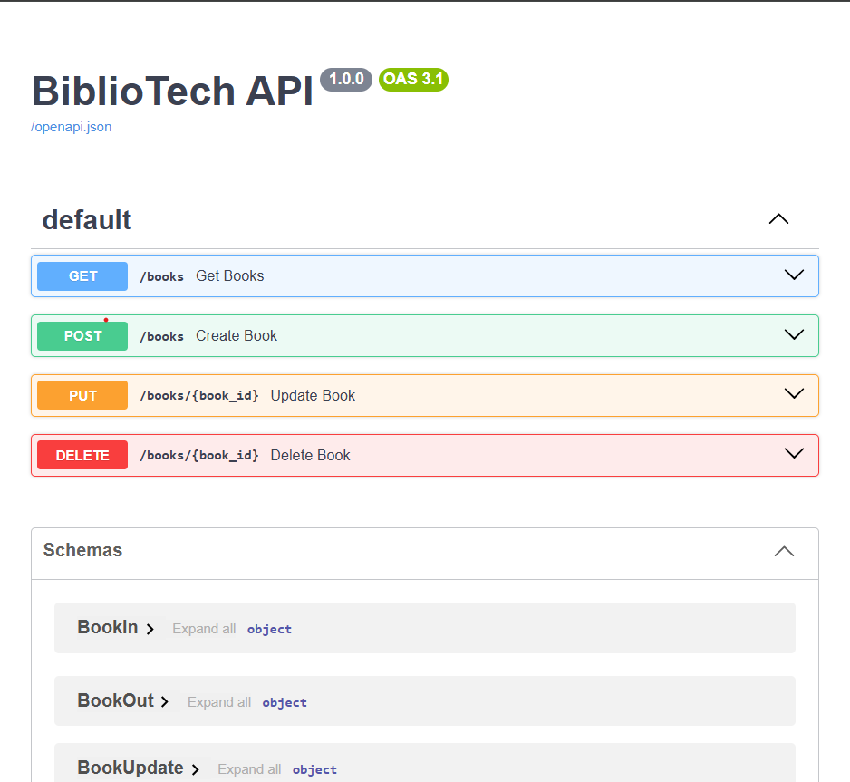
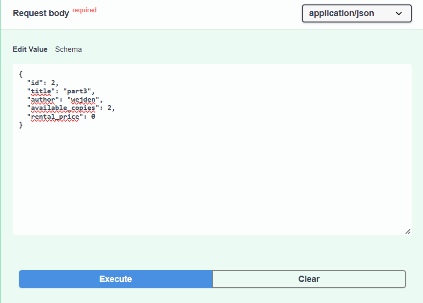
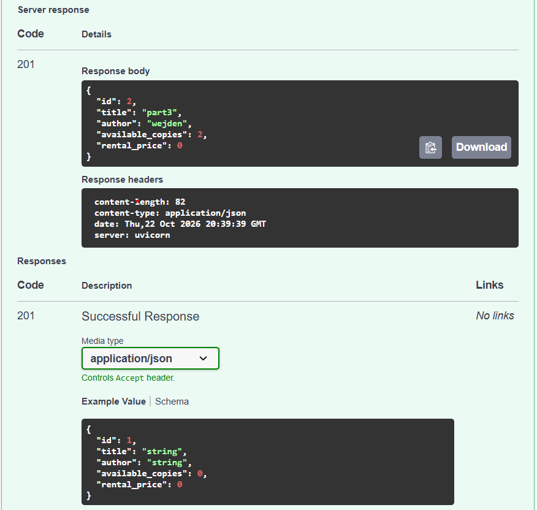

# Lab 1 — From Monolith to SOAP & REST Web Services

**Réalisé par :** Yesmine Saied — IA3.1  
**Cours :** Architecture Orientée Service (SOA)

---

## Partie 1 — Version monolithique (sans SOA)

### Objectif

Implémenter toute la logique de gestion de la bibliothèque dans un seul script Python. L'interface utilisateur (PyQt5) et l'accès à la base de données (SQLAlchemy/PostgreSQL) sont centralisés dans le fichier `monolith.py`.

### Fonctionnalités implémentées

- Connexion à la base de données PostgreSQL via SQLAlchemy.
- Opérations CRUD (Ajouter, Lire, Modifier, Supprimer) sur la table `Book`.
- Validation des données :
  - Blocage des identifiants invalides.
  - Interdiction des stocks négatifs.
  - Interdiction des tarifs négatifs.

### Question — Quelles sont les limites de cette approche monolithique ?

1. **Couplage fort :** l'interface, la logique métier et la base de données sont liées. Une modification peut donc affecter plusieurs parties du code.

2. **Accès limité :** l'application fonctionne localement et ne permet pas à d'autres applications d'accéder à ses fonctionnalités via une API.

3. **Maintenance difficile :** lorsque le projet grandit, le code devient plus complexe et plus difficile à modifier et à tester.

### Captures d'écran — Tests de la partie 1

#### 1. Test de succès : ajout et affichage des livres


#### 2. Test de validation : erreur bloquée lors d'une saisie invalide


---

## Partie 2 — Service Web SOAP

### Lancement du service

Pour démarrer le service SOAP, exécuter la commande suivante depuis un terminal ouvert à la racine du projet :

```bash
python soap_service.py
```

Le serveur écoute à l'adresse suivante :

[http://localhost:8000/](http://localhost:8000/)

### WSDL

Le contrat du service est accessible à l'adresse suivante :

[http://localhost:8000/?wsdl](http://localhost:8000/?wsdl)

Le fichier WSDL a été sauvegardé à la racine du dépôt sous le nom `library.wsdl`.

### Tests Postman

**1. Test de succès : création d'un livre valide**


**2. Test d'erreur : blocage d'un stock négatif**


### Question 6 — En quoi SOAP impose-t-il davantage de structure et de contrats que le monolithe ?

SOAP utilise un fichier WSDL qui définit les opérations disponibles et les types de données. Les échanges entre le client et le serveur se font en XML selon une structure précise. Les erreurs peuvent aussi être renvoyées dans un format standard appelé SOAP Fault.

---

## Partie 3 — API REST

### Lancement

Pour construire les images et lancer l'API ainsi que la base de données via Docker, exécuter la commande suivante :

```bash
docker-compose up --build
```

### Documentation OpenAPI

La documentation interactive (Swagger UI) est générée automatiquement et accessible aux adresses suivantes :

- **Swagger UI :** [http://localhost:8000/docs](http://localhost:8000/docs)
- **Schéma OpenAPI :** [http://localhost:8000/openapi.json](http://localhost:8000/openapi.json)

### Tests de l'API

**1. Vue d'ensemble de l'interface Swagger**



**2. Préparation de la requête de création d'un livre (`POST /books`)**



**3. Création réussie d'un livre (code HTTP 201)**



### Question 6 — Comparaison SOAP vs REST (lisibilité, facilité d'utilisation, intégration)

- **Lisibilité :** REST utilise généralement JSON, plus léger et plus facile à lire que le XML de SOAP.
- **Facilité d'utilisation :** REST utilise les méthodes HTTP (`GET`, `POST`, `PUT`, `DELETE`), ce qui facilite les opérations CRUD. SOAP suit une structure de messages plus stricte.
- **Intégration :** REST s'intègre facilement aux applications web et mobiles, notamment grâce à JSON. SOAP utilise un contrat WSDL et des messages XML qui nécessitent parfois des outils spécifiques.
